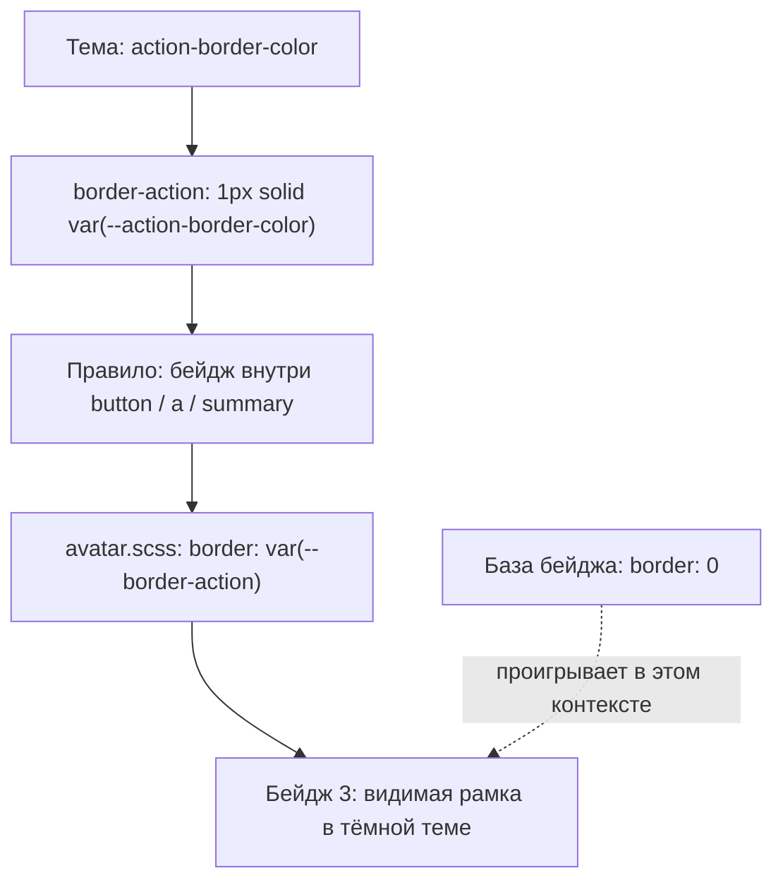

# Почему компонент выглядит именно так

Главная точка входа — [единый граф SSOT](style-graph.md). Его машинное представление
`architecture/style-graph.json` объединяет нормативную пирамиду, связи исходников,
покрытие фактических измерений и подтверждённые причинные цепочки.

Для конкретного элемента граф должен отвечать на пять вопросов:

1. Какая у элемента роль и в каком контексте он находится?
2. Какой вариант и состояние действуют сейчас?
3. Какое объявление управляет свойством, в каком файле и строке оно находится?
4. Через какие токены получено итоговое значение?
5. Какие совпавшие объявления не управляют результатом, каковы их слои, специфичность и приоритет?

## Проверенный пример: счётчик «3» внутри вкладки



[Полное доказательство](../architecture/badge-counter-explanation.json) содержит
источники, строки, исходные объявления, computed-значения, специфичность, слои и
граф зависимостей свойств. `fingerprint` связывает его с конкретной версией исходников.
В обычном информационном бейдже контекстное правило не совпадает, и действует база без рамки.
[Второй причинный граф](../architecture/badge-information-explanation.json) объясняет его фон: модификатор primary → accent-soft → палитра, отдельно от интерактивности.

## Получить объяснение другого свойства

```sh
npm run explain:style -- --selector '#demo-vtab-notify .tg-badge' --property border-top-color --theme dark
npm run explain:style -- --selector '#selection span.tg-badge--primary' --property background-color --theme light
npm run explain:style -- --selector '#buttons .tg-btn--ghost' --property border-top-color --state hover
```

Параметры: `--page workspace.html`, `--width 390`, `--theme ios-dark`,
`--state rest|hover|focus|focus-visible|active`, `--out /tmp/style-explanation.json`.
Селектор выбирает первый совпавший элемент на указанной странице.

Анализатор собирает тот же Sass в памяти с source map и открывает изолированный
Chromium. Через протокол браузера получает совпавшие правила. Затем обратимыми
пробами проверяет, какой блок объявлений действительно управляет свойством,
и рекурсивно раскрывает ссылки `var(...)` в контексте определения переменной. Локальное переопределение у потомка не приписывается значению, уже вычисленному на предке. У ссылок сохраняется исходное выражение: ветка `light-dark` или fallback может быть неактивна в текущем контексте, поэтому ссылка на токен сама по себе не объявляется доказательством его влияния на итоговый цвет. Каждая проба восстанавливается. Вкладка пользователя
и исходный CSS при анализе не меняются. Поэтому результат учитывает браузерный каскад,
а не предполагает, что последний найденный селектор обязательно победил.

Нормативный контракт не подменяет факт: если правила требуют рамку, а браузер её не
рисует, это расхождение реализации и SSOT. Для рамок такая проверка уже читает роли
непосредственно из `architecture/style-contracts.json`.

## Границы достоверности

Этот механизм подтверждает управляющий **блок объявлений**, а не универсальный
алгоритм всех причин CSS. `revert`, `revert-layer`, взаимосвязанные свойства,
зарегистрированные переменные, сложные анимации и несколько перекрывающих объявлений
в одном блоке могут требовать дополнительной проверки. Неустановленный источник
помечается `unresolved-or-browser-default`; его нельзя выдавать за доказанный.
Открытие диалогов, перетаскивание и другие сложные сценарии CLI сам не выполняет.

[Отчёт покрытия](style-reality.md) отдельно показывает наблюдавшиеся состояния и
пробелы. Полнота пока частичная: нельзя утверждать, что все возможные интерфейсы
и состояния уже измерены. Это явный долг графа, а не разрешение угадывать связи.
