# Семантический граф стилей (SSOT)

<!-- Generated by npm run graph:styles; do not edit. -->

Как объяснить конкретное свойство: [причинный граф и команды](style-explanations.md).

Фактические CSS-правила, экземпляры и computed-стили: [снимок интерфейсов и покрытие](style-reality.md). Граф не считается полным, пока есть непроверенные состояния.

Нормативные семейства и владельцы: [style-contracts.json](../architecture/style-contracts.json).
Полный граф с исходными файлами и строками: [style-graph.json](../architecture/style-graph.json).

Пирамида направлена сверху вниз: токены и темы → примитивы-владельцы → семейства → модули компонентов. Каждый уровень специализирует предыдущий. У компонента могут быть несколько родителей по разным обязанностям: например поверхность, выбор и обрезка медиа. Обратные связи и циклы запрещены проверкой уровней. Технические зависимости сохранены отдельно в evidence; они не являются связями наследования.

```mermaid
flowchart TB
  root["Токены → темы → базовые правила"]
  root --> o0["components/floating.surface"]
  o0 --> f0["Всплывающие поверхности"]
  f0 --> c_components_bottom_panel["components/bottom-panel"]
  f0 --> c_components_charts["components/charts"]
  f0 --> c_components_compositions["components/compositions"]
  f0 --> c_components_editor["components/editor"]
  f0 --> c_components_feedback["components/feedback"]
  f0 --> c_components_option["components/option"]
  f0 --> c_components_overlays["components/overlays"]
  root --> o1["components/option.dropdown-row"]
  o1 --> f1["Строки выбора и команд"]
  f1 --> c_components_app_nav["components/app-nav"]
  f1 --> c_components_menu["components/menu"]
  f1 --> c_components_option["components/option"]
  f1 --> c_components_overlays["components/overlays"]
  f1 --> c_components_pickers["components/pickers"]
  root --> o2["components/option.group-label"]
  o2 --> f2["Заголовки групп"]
  f2 --> c_components_app_nav["components/app-nav"]
  f2 --> c_components_menu["components/menu"]
  f2 --> c_components_option["components/option"]
  f2 --> c_components_overlays["components/overlays"]
  root --> o3["components/selected.segment-current"]
  o3 --> f3["Выбор и активные состояния"]
  f3 --> c_components_navigation["components/navigation"]
  f3 --> c_components_option["components/option"]
  root --> o4["components/field-surface.frame"]
  o4 --> f4["Поверхность поля"]
  f4 --> c_components_calendar["components/calendar"]
  f4 --> c_components_pickers["components/pickers"]
  root --> o5["components/media-surface.clip"]
  o5 --> f5["Скруглённое медиа"]
  f5 --> c_components_avatar["components/avatar"]
  f5 --> c_components_carousel["components/carousel"]
  f5 --> c_components_content["components/content"]
  f5 --> c_components_effects["components/effects"]
  f5 --> c_components_media["components/media"]
  f5 --> c_components_pickers["components/pickers"]
  f5 --> c_components_surfaces["components/surfaces"]
  root --> o6["components/panel-parts.meta-footer"]
  o6 --> f6["Служебные строки панелей"]
  f6 --> c_components_editor["components/editor"]
  f6 --> c_components_overlays["components/overlays"]
  root --> o7["components/steps.marker"]
  o7 --> f7["Шаги и временная шкала"]
  f7 --> c_components_progress["components/progress"]
  f7 --> c_components_steps["components/steps"]
  root --> o8["components/track.scroller"]
  o8 --> f8["Прокручиваемые дорожки"]
  f8 --> c_components_carousel["components/carousel"]
  root --> o9["components/error-surface.surface"]
  o9 --> f9["Поверхности ошибок"]
  f9 --> c_components_patterns["components/patterns"]
  root --> o10["components/control-states"]
  o10 --> f10["Интерактивные состояния"]
  f10 --> c_components_control_states["components/control-states"]
  root --> o11["components/buttons"]
  o11 --> f11["Кнопки"]
  f11 --> c_components_buttons["components/buttons"]
  root --> o12["components/feedback"]
  o12 --> f12["Индикаторы загрузки"]
  f12 --> c_components_feedback["components/feedback"]
  root --> o13["base"]
  o13 --> f13["base"]
  f13 --> c_base["base"]
  root --> o14["components/actions"]
  o14 --> f14["actions"]
  f14 --> c_components_actions["components/actions"]
  root --> o15["components/button-feedback"]
  o15 --> f15["button-feedback"]
  f15 --> c_components_button_feedback["components/button-feedback"]
  root --> o16["components/forms"]
  o16 --> f16["forms"]
  f16 --> c_components_forms["components/forms"]
  root --> o17["components/icons"]
  o17 --> f17["icons"]
  f17 --> c_components_icons["components/icons"]
  root --> o18["components/upload"]
  o18 --> f18["upload"]
  f18 --> c_components_upload["components/upload"]
  root --> o19["utilities"]
  o19 --> f19["utilities"]
  f19 --> c_utilities["utilities"]
  root --> boundary["Общий контракт интерактивности"]
  boundary --> role0["Действие"]
  role0 --> rule0["Рамка: обязательна"]
  boundary --> role1["Бейдж внутри действия"]
  role1 --> rule1["Рамка: обязательна"]
  boundary --> role2["Информационный бейдж"]
  role2 --> rule2["Рамка: отсутствует"]
```

## Контракт интерактивности

Любое действие имеет видимую рамку. Информационные подписи и бейджи не получают рамку действия.

Варианты меняют заливку, цвет и форму; состояния меняют доступность и выбор. Они не могут отменять рамку действия.

| Роль | Рамка | Владелец реализации |
| --- | --- | --- |
| Действие | required | components/control-states |
| Бейдж внутри действия | required | components/avatar |
| Информационный бейдж | none | components/avatar |

Все роли используют один токен action-border-color; рамка не исчезает у ghost, selected или disabled. Переключатель рисует её на ::before. Структурные рамки поверхностей — отдельная роль.

## Контракты

| Семейство | Владелец | Ответственность |
| --- | --- | --- |
| Всплывающие поверхности | [components/floating.surface](../src/components/_floating.scss) | Фон, цвет текста, рамка, тень; радиус передаётся параметром. |
| Строки выбора и команд | [components/option.dropdown-row](../src/components/_option.scss) | Геометрия и оформление строки; выбранное состояние делегируется selected. |
| Заголовки групп | [components/option.group-label](../src/components/_option.scss) | Типографика и отступы заголовка группы. |
| Выбор и активные состояния | [components/selected.segment-current](../src/components/_selected.scss) | Общие состояния выбора; soft, filled и ring остаются разными вариантами. |
| Поверхность поля | [components/field-surface.frame](../src/components/_field-surface.scss) | Рамка, радиус и фон; surface добавляет состояния составного поля. |
| Скруглённое медиа | [components/media-surface.clip](../src/components/_media-surface.scss) | Единый композитинг и обрезка медиа; радиус и размещение задаёт компонент. |
| Служебные строки панелей | [components/panel-parts.meta-footer](../src/components/_panel-parts.scss) | Разделитель, отступы и типографика служебной строки. |
| Шаги и временная шкала | [components/steps.marker](../src/components/_steps.scss) | Маркеры, соединения и состояния; направление и компоновка задаются компонентом. |
| Прокручиваемые дорожки | [components/track.scroller](../src/components/_track.scss) | Прокрутка и snap по выбранной оси. |
| Поверхности ошибок | [components/error-surface.surface](../src/components/_error-surface.scss) | Общее оформление ошибки; layout и части подключаются отдельно. |
| Интерактивные состояния | [components/control-states](../src/components/_control-states.scss) | Общий движок hover, active и disabled, параметризованный --control-*. |
| Кнопки | [components/buttons](../src/components/_buttons.scss) | Контракт кнопок и параметры primary, destructive, ghost, pill; состояния принадлежат control-states. |
| Индикаторы загрузки | [components/feedback](../src/components/_feedback.scss) | Нативная и составная полоса: высота, цвет, круглые окончания; полосатость — вариант. |
| base | [base](../src/base/_index.scss) | Собственный контракт модуля; общие части делегируются подключаемым примитивам. |
| actions | [components/actions](../src/components/_actions.scss) | Собственный контракт модуля; общие части делегируются подключаемым примитивам. |
| button-feedback | [components/button-feedback](../src/components/_button-feedback.scss) | Собственный контракт модуля; общие части делегируются подключаемым примитивам. |
| forms | [components/forms](../src/components/_forms.scss) | Собственный контракт модуля; общие части делегируются подключаемым примитивам. |
| icons | [components/icons](../src/components/_icons.scss) | Собственный контракт модуля; общие части делегируются подключаемым примитивам. |
| upload | [components/upload](../src/components/_upload.scss) | Собственный контракт модуля; общие части делегируются подключаемым примитивам. |
| utilities | [utilities](../src/utilities/_index.scss) | Собственный контракт модуля; общие части делегируются подключаемым примитивам. |

## Все модули

| Модуль | Общие миксины, которые он подключает |
| --- | --- |
| [layers](../src/_layers.scss) | — |
| [base](../src/base/_index.scss) | — |
| [components/actions](../src/components/_actions.scss) | — |
| [components/app-nav](../src/components/_app-nav.scss) | components/option#group-label, components/option#row, components/option#list, components/option#dropdown-row, components/option#chosen, components/option#meta |
| [components/avatar](../src/components/_avatar.scss) | components/media-surface#clip |
| [components/bottom-panel](../src/components/_bottom-panel.scss) | components/floating#surface |
| [components/button-feedback](../src/components/_button-feedback.scss) | — |
| [components/buttons](../src/components/_buttons.scss) | components/selected#soft, components/selected#filled |
| [components/calendar](../src/components/_calendar.scss) | components/field-surface#frame |
| [components/carousel](../src/components/_carousel.scss) | components/track#scroller, components/media-surface#clip, components/track#fade-mask |
| [components/charts](../src/components/_charts.scss) | components/floating#surface |
| [components/compositions](../src/components/_compositions.scss) | components/floating#surface |
| [components/content](../src/components/_content.scss) | components/content#key, components/media-surface#clip |
| [components/control-hover](../src/components/_control-hover.scss) | — |
| [components/control-states](../src/components/_control-states.scss) | — |
| [components/editor](../src/components/_editor.scss) | components/panel-parts#meta-footer, components/floating#surface |
| [components/effects](../src/components/_effects.scss) | components/media-surface#clip |
| [components/error-surface](../src/components/_error-surface.scss) | — |
| [components/extensions](../src/components/_extensions.scss) | — |
| [components/feedback](../src/components/_feedback.scss) | components/floating#surface |
| [components/field-surface](../src/components/_field-surface.scss) | components/field-surface#frame |
| [components/floating](../src/components/_floating.scss) | — |
| [components/forms](../src/components/_forms.scss) | components/field-surface#surface, components/field-surface#bare-control |
| [components/icons](../src/components/_icons.scss) | — |
| [components/media-surface](../src/components/_media-surface.scss) | — |
| [components/media](../src/components/_media.scss) | components/media-surface#clip |
| [components/menu](../src/components/_menu.scss) | components/option#list, components/floating#popover, components/floating#anchored, components/option#dropdown-row, components/option#active, components/option#mark, components/option#chosen, components/option#meta, components/option#group-label, components/floating#sheet |
| [components/navigation](../src/components/_navigation.scss) | components/selected#track, components/selected#segment, components/selected#segment-current, components/selected#segment-hover |
| [components/option](../src/components/_option.scss) | components/floating#surface, components/option#row, components/selected#segment-current |
| [components/overlays](../src/components/_overlays.scss) | components/floating#surface, components/floating#popover, components/option#group-label, components/option#dropdown-row, components/option#meta, components/panel-parts#meta-footer |
| [components/panel-parts](../src/components/_panel-parts.scss) | — |
| [components/patterns](../src/components/_patterns.scss) | components/field-surface#surface, components/field-surface#bare-control, components/error-surface#surface, components/error-surface#layout, components/error-surface#icon, components/error-surface#content, components/error-surface#title |
| [components/pickers](../src/components/_pickers.scss) | components/field-surface#frame, components/option#list, components/floating#popover, components/floating#sheet, components/option#dropdown-row, components/option#active, components/option#chosen, components/option#mark, components/option#meta, components/field-surface#surface, components/field-surface#bare-control, components/selected#ring, components/media-surface#clip, components/selected#soft |
| [components/progress](../src/components/_progress.scss) | components/steps#through-line, components/steps#marker, components/steps#marker-states, components/steps#text-at-marker-top |
| [components/selected](../src/components/_selected.scss) | — |
| [components/steps](../src/components/_steps.scss) | — |
| [components/surfaces](../src/components/_surfaces.scss) | components/media-surface#clip |
| [components/track](../src/components/_track.scss) | — |
| [components/upload](../src/components/_upload.scss) | — |
| [index](../src/index.scss) | — |
| [telegram](../src/telegram.scss) | themes/colors#bindings |
| [themes/colors](../src/themes/_colors.scss) | — |
| [themes](../src/themes/_index.scss) | themes#light, themes/colors#bindings, themes#desktopDark, themes#iosDark |
| [tokens](../src/tokens/_index.scss) | — |
| [utilities](../src/utilities/_index.scss) | — |

## Правила использования

- Общее оформление меняется у владельца семейства; компоненты задают параметры и компоновку.
- Смысловые варианты и состояния сохраняются; визуальное сходство само по себе не означает наследование.
- Новый общий стиль сначала получает владельца здесь, затем реализацию и проверку. Локальные копии и !important запрещены.
- Фактические связи извлекаются из Sass. Сходство computed styles — кандидат на объединение, а не нормативная связь.
- Пирамида: фундамент → примитив-владелец → семейство → компонент. Переопределения допустимы через публичные параметры и состояния; обратные зависимости и копирование общих правил запрещены.

1. Перед изменением найдите семейство и владельца; фактические потребители доступны по includes и uses.
2. Меняйте общую реализацию у владельца. Новое семейство или смену ответственности фиксируйте в style-contracts.json.
3. Выполните npm run graph:styles и включите обновлённые графы в изменение. npm test проверяет, что они соответствуют исходникам.
4. Визуальное наследование подтверждайте браузерными тестами. Этот граф фиксирует исходные зависимости, а не вычисляет CSS-каскад.

Граф охватывает все Sass-модули src, их @use, @include, чтения и объявления CSS-переменных, а также буквальные .tg-* селекторы. Вложенные &__* селекторы не разворачиваются. Интерполированные переменные, JS, inline-стили и внешние host-переопределения требуют отдельной проверки. Токены могут иметь несколько определений в темах и состояниях; defines-token не назначает единственного владельца токена.
